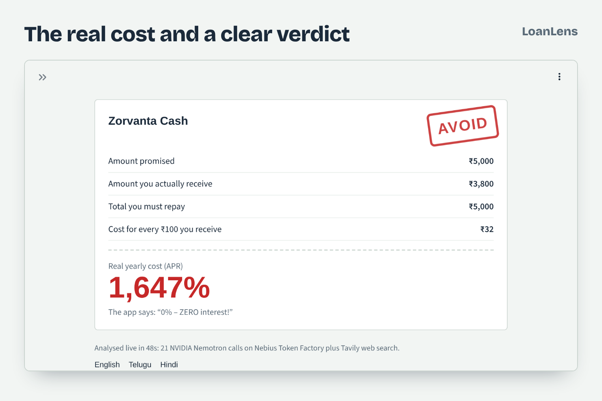
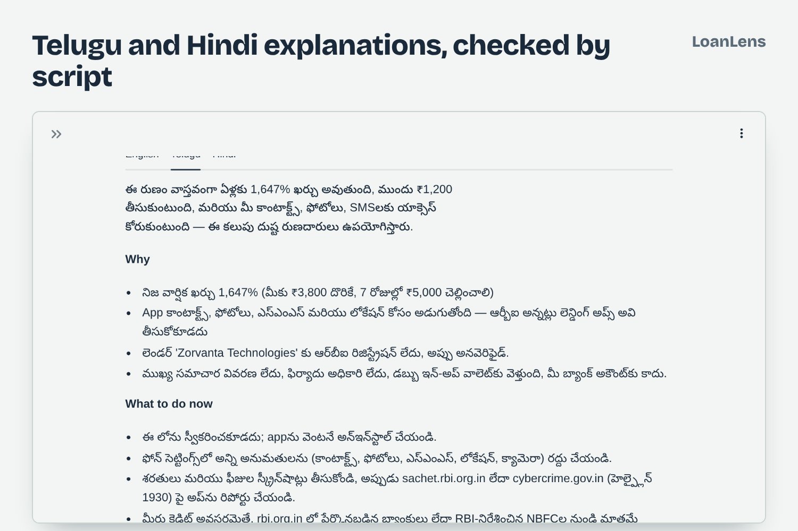

# LoanLens

**See the real cost of a loan app before you tap accept.**

LoanLens is an AI agent that reads an Indian digital-lending offer (pasted text, a screenshot, or just the app's name), computes the true annual cost, checks the terms against RBI digital lending protections, verifies the lender on the live web, and gives a plain-language verdict in English, Telugu or Hindi.

Built for the **Nebius x NVIDIA Global AI Hackathon** (Best Apps and Agents track) with **NVIDIA Nemotron** models on **Nebius Token Factory** and **Tavily** search.

- **Live demo:** https://loanlens-nemotron.streamlit.app
- **Demo video:** _add your YouTube URL here_




## Why

Instant-loan apps advertise "0% interest" while cutting large fees before the money arrives, charging daily penalties, and asking for access to your contact list. Recovery agents of unregulated apps have used that access to shame borrowers to their families, and harassment by loan-app agents in Andhra Pradesh and Telangana has been reported as linked to suicides ([example](https://www.thenewsminute.com/article/andhra-man-dies-suicide-allegedly-after-torture-loan-app-agents-172666), [example](https://www.thenewsminute.com/article/andhra-teen-dies-suicide-due-harassment-loan-recovery-agents-166348)). The rules that protect borrowers exist; the information just doesn't reach the person at the moment they decide.

A "₹5,000 for 7 days, 0% interest" offer that deducts a ₹1,200 fee looks harmless. LoanLens shows what it really is:

$$\text{APR} = \frac{1200}{3800} \times \frac{365}{7} \approx 1{,}647\%$$

## How it works

```
input (text / screenshot / app name)
  1. Extract terms         Nemotron Nano (Nemotron 3.5 Super VL for images)   -> strict JSON
  2. Compute true cost     Python (deterministic: APR, IRR for EMIs, GST)
  3. Rule checks           Python checklist based on RBI digital lending rules
  4. Verify the lender     Tavily search  ->  Nemotron Super summarises evidence with sources
  5. Verdict               Nemotron 3 Ultra weighs cost + flags + evidence -> AVOID / RISKY / SAFE
  6. Explain               Nemotron 3 Ultra writes Telugu and Hindi, with a script-purity check and retry
```

### How NVIDIA Nemotron is used

| Step | Model (default ID, configurable) | Why this size |
|---|---|---|
| Term extraction | `nvidia/NVIDIA-Nemotron-3-Nano-30B-A3B` | Fast, cheap, reliable JSON |
| Screenshot reading | `nvidia/Nemotron-3.5-Super-VL` | Multimodal input |
| Evidence summary | `nvidia/nemotron-3-super-120b-a12b` | Careful reading of several web sources |
| Final verdict | `nvidia/Nemotron-3-Ultra-550b-a55b` | Multi-factor reasoning |
| Telugu and Hindi | `nvidia/Nemotron-3-Ultra-550b-a55b` | Nano and Super mixed in stray characters from other scripts in Telugu; Ultra is clean, and every output is script-checked |

Model routing keeps simple steps fast and cheap, and saves Ultra for the verdict and for Telugu and Hindi, where smaller models made mistakes.

### Where Nebius Token Factory fits

All model calls go through Token Factory's OpenAI-compatible endpoint (`https://api.tokenfactory.nebius.com/v1/`) using the standard `openai` SDK, so swapping between Nano, Super and Ultra is a one-line change. The app's **Agent trace** panel shows every call, its model and latency.

`jobs/watchlist_job.py` is built to run as a **Nebius Serverless Job**: it analyses a list of loan apps in the background and writes a risk watchlist.

### Design choices

- **The model never does money math.** It only extracts inputs; every number shown is computed in `loanlens/apr.py` and unit-tested.
- **Evidence or nothing.** The lender check must cite Tavily sources; "couldn't verify" is shown honestly instead of as an accusation.
- **Works offline.** Without API keys, the true-cost math and rule checks still run on the sample offers.
- **No legal or financial strategy.** The verdict never tells a borrower to withhold or reduce repayment and never names commercial products; it points to the RBI complaint portal, the cybercrime helpline (1930) and the consumer helpline (1915).
- **Translations are validated.** Nano and Super mixed in letters from other Indic scripts in Telugu, so Ultra translates sentence by sentence and each sentence is rejected if it has stray scripts, is cut off, or echoes instructions.

## What we learned on Token Factory

- Reasoning tokens count against `max_tokens`. A generation can stop with `finish_reason="length"` and a partial answer, so `llm.py` never returns a cut-off answer: it retries with a doubled budget.
- Model IDs differ in casing across the catalog (`nvidia/NVIDIA-Nemotron-3-Nano-30B-A3B` vs `nvidia/Nemotron-3-Ultra-550b-a55b`), so IDs are configurable.
- The three sample offers are fictional. The names were checked against live search so they don't match real lenders.

## Run it locally

```bash
git clone https://github.com/abdulmannaan502/loanlens.git
cd loanlens
pip install -r requirements.txt
cp .streamlit/secrets.toml.example .streamlit/secrets.toml   # add your keys
streamlit run app.py
```

Keys:
- `NEBIUS_API_KEY`: from [Nebius Token Factory](https://tokenfactory.nebius.com)
- `TAVILY_API_KEY`: from [Tavily](https://tavily.com)
- Optional `MODEL_NANO`, `MODEL_SUPER`, `MODEL_ULTRA`, `MODEL_VISION` to match your Token Factory catalog.

Run tests with `pytest`.

## Deploy

- **Streamlit Community Cloud:** point it at `app.py` and add the keys under *Secrets*.
- **Nebius Serverless Job** for the watchlist:
  ```bash
  python -m jobs.watchlist_job apps.txt watchlist.json
  ```

## Project structure

```
app.py                  Streamlit UI
loanlens/llm.py         Nemotron client for Nebius Token Factory, model routing, JSON validation
loanlens/pipeline.py    The agent pipeline and prompts
loanlens/apr.py         Deterministic cost math (APR, IRR, GST)
loanlens/rules.py       RBI-based red-flag checklist
loanlens/verify.py      Tavily lender verification
loanlens/samples.py     Fictional sample offers
jobs/watchlist_job.py   Batch job for Nebius Serverless Jobs
tests/                  Unit tests
```

## Disclaimer

LoanLens is an awareness tool, not legal or financial advice. The sample apps are fictional. To report an illegal lending app in India, use [sachet.rbi.org.in](https://sachet.rbi.org.in) or [cybercrime.gov.in](https://cybercrime.gov.in) (helpline 1930).

## License

MIT
